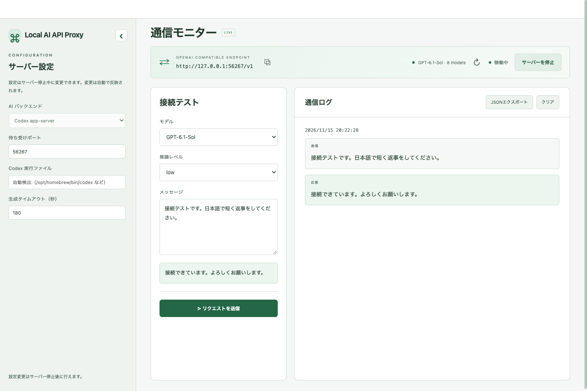

# Local AI API Proxy



*Codex app-server で実際に接続テストを行った画面です。撮影時は別ポートを使用しています。既定の Base URL は `http://127.0.0.1:8787/v1` です。*

Codex app-server または Antigravity CLI を通して、ローカルの OpenAI API 互換 REST API を提供する Mac アプリです。外部アプリからの通信を受け付け、送信メッセージと AI の応答を同じ画面で確認できます。推論は各 CLI の接続先で実行されるため、利用する CLI のインストール・ログインとネットワーク接続が必要です。

## 主な機能

- Codex app-server / Antigravity CLI の切り替え。
- OpenAI 互換の Chat Completions / Responses API、SSE、JSON Schema 出力。
- 左サイドバーのサーバー設定、中央の接続テスト、右側の通信ログを常時表示。
- 設定の自動保存と、サーバー稼働中の設定変更ロック。
- 秒までの日時付きログ、JSON エクスポート、ログのクリア。
- サイドバーの開閉と、開閉状態の保存。

## 起動する

### 準備

macOS、Node.js、npm と、利用するバックエンドの CLI を準備してください。

| バックエンド | ログイン・確認 | 実行ファイルの自動検出 |
| --- | --- | --- |
| Codex app-server | `codex login` | `/opt/homebrew/bin/codex`、`/usr/local/bin/codex`、`/Applications/Codex.app/Contents/Resources/codex`、PATH の順 |
| Antigravity CLI | `agy` を起動してログイン。`agy models` でモデルを確認 | `~/.local/bin/agy`、`/opt/homebrew/bin/agy`、`/usr/local/bin/agy`、PATH の順 |

Antigravity は非対話実行に対応する **`agy` CLI** を使用します。IDE 用の `antigravity` コマンドとは異なります。認証情報をこのアプリに入力する必要はありません。

初回はプロジェクト内で依存パッケージをインストールします。

```sh
npm ci
./start.sh
```

以降は `./start.sh` で起動できます。別のディレクトリからスクリプトの絶対パスを指定しても起動できます。

### サーバーを起動・切り替える

1. 左の「サーバー設定」で AI バックエンドを選択します。必要ならポート、実行ファイルの絶対パス、生成タイムアウトを変更します。
2. 設定は自動保存されます。保存ボタンはありません。入力エラーや反映結果はサイドバー下部に表示されます。
3. URL 表示エリアの右側にある「サーバーを起動」を押します。選択したバックエンドからモデル一覧を取得し、API の待ち受けを開始します。
4. バックエンドや接続設定を変更するときは、「サーバーを停止」を押してから変更し、再び起動します。

**稼働中・起動中・停止処理中は、サーバー設定の全項目を編集できません。** 停止すると再び編集できます。サーバーを停止すると、実行中の生成も中断します。

| 設定 | 既定値・範囲 |
| --- | --- |
| AI バックエンド | 初回は Codex app-server。以降は保存した設定を使用 |
| 待ち受けポート | `8787`。`1024`〜`65535` |
| 実行ファイル | 空欄なら自動検出 |
| 生成タイムアウト | `180` 秒。`10`〜`3600` 秒 |

サイドバーは固定幅です。上部の「Local AI API Proxy」の右端にあるボタンで開閉します。閉じた状態でも、左端に残るボタンから開き直せます。開閉状態は次回起動時にも保持されます。

## 接続テストと通信ログ

「接続テスト」でモデルとメッセージを指定し、「リクエストを送信」を押すと、ローカル API を通して接続を確認できます。サーバー設定に既定モデルや推論レベルを保存する機能はありません。

- **Codex:** 選択モデルが対応する推論レベルを選択できます。「モデルの既定値」では `reasoning_effort` を送信しません。
- **Antigravity:** 推論レベル欄は選択不可です。強度の違いがある場合は、`-low` / `-medium` / `-high` などを含むモデル名から選択してください。

モデル一覧はサーバー起動時、`GET /v1/models`、URL 表示エリアの更新ボタンで取得します。モデルの実際の利用可否は、アカウントや接続先に依存します。

右の「通信ログ」には、Chat Completions / Responses の送信メッセージ、AI の応答、エラーを日時順に表示します。日時はこの Mac の時刻で、秒まで表示します。生成中の応答も随時更新します。ヘルスチェックやモデル一覧取得の通信は、この欄には表示しません。

| ヘッダーの操作 | 動作 |
| --- | --- |
| JSONエクスポート | 表示対象の通信を日時順の JSON 配列として保存。保存先を選択でき、日時・リクエスト・応答・使用量・イベントなどを含む |
| クリア | 画面のログと保存済み JSONL、ローテーション済み JSONL を削除。通信中は操作不可 |

生成中でも JSON エクスポートは利用でき、ボタンを押した時点の内容を書き出します。

## 外部アプリから接続する

既定の Base URL は **`http://127.0.0.1:8787/v1`** です。ポートを変更した場合は、画面に表示される URL を使用してください。URL 横のボタンでコピーできます。

API キー入力が必須のクライアントでは、`local` など任意の文字列を指定できます。このローカルサーバーは API キー認証を行いません。待ち受けは IPv4 の `127.0.0.1` に固定しています。

### Python OpenAI SDK

```python
from openai import OpenAI

client = OpenAI(base_url="http://127.0.0.1:8787/v1", api_key="local")
model = client.models.list().data[0].id

reply = client.chat.completions.create(
    model=model,
    messages=[
        {"role": "system", "content": "簡潔な日本語で回答してください。"},
        {"role": "user", "content": "こんにちは！"},
    ],
)
print(reply.choices[0].message.content)

stream = client.responses.create(model=model, input="接続テストです。", stream=True)
for event in stream:
    if event.type == "response.output_text.delta":
        print(event.delta, end="", flush=True)
```

### JavaScript OpenAI SDK

```js
import OpenAI from 'openai';

const client = new OpenAI({ baseURL: 'http://127.0.0.1:8787/v1', apiKey: 'local' });
const { data: models } = await client.models.list();
const stream = await client.chat.completions.create({
  model: models[0].id,
  messages: [{ role: 'user', content: 'ひとことで挨拶してください。' }],
  stream: true,
  stream_options: { include_usage: true },
});
for await (const chunk of stream) {
  process.stdout.write(chunk.choices[0]?.delta?.content ?? '');
}
```

ローカルで開発中の Web アプリからも使えます。CORS は `http(s)://localhost:<port>` と `http(s)://127.0.0.1:<port>` の Origin に対応し、それ以外は拒否します。ブラウザ用 OpenAI SDK では、同 SDK の `dangerouslyAllowBrowser` 設定が必要です。

## API の対応範囲

| API / 機能 | Codex app-server | Antigravity CLI |
| --- | --- | --- |
| `GET /health` | サーバー状態とバックエンド名 | 同左 |
| `GET /v1/models` | `model/list` をページ送りして取得 | `agy models` から取得 |
| `POST /v1/chat/completions` | テキスト応答、SSE、`stream_options.include_usage` | 同左 |
| `POST /v1/responses` | テキスト応答、Responses 形式の SSE | 同左 |
| system / developer / user / assistant | テキストとテキストパート配列 | 同左 |
| `reasoning_effort` / `reasoning.effort` | モデルの対応値を検証して転送 | 未対応。モデル名で強度を選択 |
| `response_format.type=json_schema` | スキーマを `outputSchema` に転送 | `--json-schema` に転送 |
| `text.format.type=json_schema` | 同上 | 同上 |
| `user`（Chat Completions） / `metadata` / `store` | 互換性のため受理。ユーザー管理や Responses の保存・取得機能は提供しない | 同左 |
| 画像・音声・ファイル・Embeddings | 未対応 | 未対応 |
| `tools` / tool calls / tool messages | 未対応 | 未対応 |
| `temperature` / `top_p` / `max_tokens` / `max_output_tokens` / `stop` / `seed` / logprobs / `n>1` | 未対応 | 未対応 |
| `previous_response_id` / Responses 取得・削除 / background | 未対応 | 未対応 |
| JSON object モード | 未対応。JSON Schema を使用 | 同左 |

OpenAI API 全体を完全に再現するものではありません。未対応のパラメーターには `400 unsupported_parameter` などのエラーを返します。クライアントが `temperature` や `max_tokens` を自動付与する場合は、その設定を外してください。

モデルを省略した場合は、バックエンドのカタログで既定として扱うモデル、一覧の先頭の順に選びます。Antigravity では `agy models` の先頭を既定として扱います。

### 会話・実行の扱い

各 API リクエストは独立しています。会話履歴は毎回 `messages` または `input` に含めてください。画面の接続テストはユーザーメッセージを送信します。API 経由では system / developer メッセージや Responses の `instructions` も指定できます。

- **Codex:** リクエストごとに ephemeral な thread を作成します。system / developer は developer instructions に変換し、複数の user / assistant メッセージはロール付き JSON の会話データとして渡します。作業ディレクトリはアプリ専用、sandbox は read-only、承認ポリシーは `never` です。生成 thread のシェル・Web 検索・Apps・継承した MCP サーバーを無効にします。
- **Antigravity:** リクエストごとに専用の作業ディレクトリとテキスト生成用エージェントを作成し、CLI の NDJSON 入出力を変換します。ツールは完了通知用の `finish` のみを許可し、スラッシュコマンド展開を無効にします。JSON Schema 出力は最終結果を受け取ってから本文を送ります。CLI 側に会話履歴が残る場合があり、ephemeral の保証はありません。

プロンプトの配置やトークン数はネイティブ OpenAI API と完全には一致しません。使用量はバックエンドが通知した値を返します。ユーザーの CLI 設定や認証情報を書き換えることはありません。

同時生成は最大16件、リクエスト本文は最大2 MiBです。クライアント切断・タイムアウト・サーバー停止で生成を中断します。Codex では `turn/interrupt`、Antigravity では該当 CLI プロセスの終了を使用します。SSE 開始後の失敗は、Chat Completions では `error` データ、Responses では `response.failed` イベントに表示します。

## 設定とログの保存先

| 起動方法 | 保存先 |
| --- | --- |
| Mac アプリ | `~/Library/Application Support/Codex Local API/` |
| 開発用 GUI（`./start.sh` / `npm start`） | `~/Library/Application Support/codex-local-api/` |
| CLI（`npm run server`） | 起動したディレクトリ内の `.local-data/` |

アプリ名を変更しても既存データを引き継ぐため、GUI の保存先には旧名称を継続使用しています。`CODEX_LOCAL_DATA` で設定・通信ログの保存先を指定することもできます。サイドバーの開閉状態などの画面設定は、GUI のプロファイルに保存します。

- `settings.json`: バックエンド、ポート、各 CLI の実行ファイル、生成タイムアウト。
- `logs/requests.jsonl`: 完了した通信を JSONL 形式で保存。20 MiB を超えると `.1` にローテーション。
- 画面は直近最大300件を保持し、再起動時はファイル末尾の最大8 MiBを読み込みます。JSON エクスポートの対象は、そのうち画面に表示する Chat Completions / Responses の通信です。
- 保存内容は本文・応答・エラー・使用量・バックエンドイベントなどです。Authorization ヘッダーや CLI の認証情報は記録しません。本文中に含めた値はそのまま保存されます。

## GUI なしで起動する

```sh
npm run server
```

Antigravity を使う場合:

```sh
AI_BACKEND=antigravity npm run server
```

| 環境変数 | 用途 |
| --- | --- |
| `AI_BACKEND` | `codex` / `antigravity` |
| `PORT` | 待ち受けポート |
| `CODEX_BINARY` | Codex 実行ファイルのパス |
| `ANTIGRAVITY_BINARY` | `agy` 実行ファイルのパス |
| `CODEX_LOCAL_DATA` | 設定・通信ログの保存先（GUI でも利用可能） |

CLI は保存済み設定を読み込み、指定された環境変数の値で上書きして保存します。終了は `Ctrl+C` です。

## Mac アプリをビルドする

```sh
./build-mac.sh
```

依存パッケージのインストール、Electron の準備、`.app` のビルド、ローカル署名の検証を行います。初回はダウンロードのためネットワーク接続が必要です。

| Node.js のアーキテクチャ | 出力先 |
| --- | --- |
| Apple Silicon（arm64） | `dist/mac-arm64/Local AI API Proxy.app` |
| Intel（x64） | `dist/mac/Local AI API Proxy.app` |

ビルド済みアプリは Finder から開くか、`./start.sh --packaged` で起動できます。Applications フォルダにコピーすることもできます。生成するアプリはローカル用の ad-hoc 署名です。Developer ID 署名・公証は行いません。

個別のコマンド:

```sh
npm start       # 開発用 GUI
npm run server  # GUI なしでサーバー起動
npm test        # HTTP / JSONL / OpenAI SDK / ログ出力などの自動テスト
npm run build   # .app をビルド
npm run dist    # DMG を作成（配布用署名・公証は別途必要）
```

### 実バックエンドと GUI のスモークテスト

通常起動しているアプリを終了してから実行してください。

```sh
npm start -- --smoke                       # 起動・モデル取得・GUI を確認
npm start -- --smoke --smoke-inference     # 実生成を3回実行
npm start -- --smoke --smoke-antigravity   # Antigravity で起動を確認
npm start -- --smoke --smoke-antigravity --smoke-inference
npm start -- --packaged --smoke            # ビルド済みアプリを確認
```

`--smoke-antigravity` を指定しない場合は、スモークテスト用の保存設定のバックエンドを使用します。実生成は選択したバックエンドの利用枠を使用します。開発起動ではデータを `.local-data/gui-smoke/` に、画像を `.local-data/gui-smoke.png` に出力します。パッケージ版では一時ディレクトリ内の `local-ai-api-proxy-smoke/` を使用します。

参考仕様: [Codex App Server](https://learn.chatgpt.com/docs/app-server)、[Antigravity headless mode](https://antigravity.google/docs/cli/headless)。
